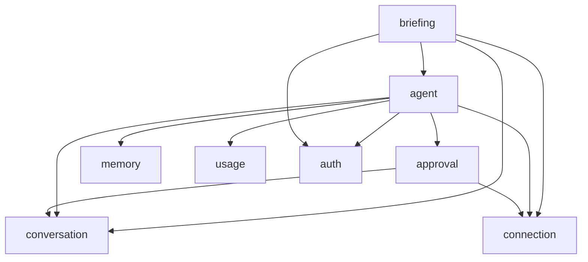

# 아키텍처

minipickle의 서비스 구성, Spring 모듈, 애그리거트를 정리한다. 테이블과 컬럼은 [erd.md](erd.md), 용어는 [GLOSSARY.md](../GLOSSARY.md), 결정의 이유는 [docs/adr/](adr/)에 있다.

## 서비스

| 서비스 | 하는 일 |
|---|---|
| **React** (`frontend/`) | 화면. Spring하고만 통신한다 |
| **Spring** (`backend/`) | 시스템의 기준. DB, Google 토큰, 도구 실행, 스케줄러를 모두 맡는다 (ADR 0002) |
| **Python** (`ai/`) | Claude로 에이전트 루프를 돌려 "어떤 도구를 어떤 값으로 부를지"만 정한다. 상태와 비밀값이 없다 |
| **PostgreSQL** | Spring만 접근한다 (ADR 0003) |

### 통신

| 방향 | 방식 | 예 |
|---|---|---|
| React → Spring | HTTP. 메시지를 보내면 `202 Accepted`를 받고, 답을 기다리는 동안 새 메시지를 폴링한다 (ADR 0008) | `POST /api/messages`, `GET /api/messages?after={id}` |
| Spring → Python | HTTP. 루프가 끝날 때까지 요청이 열려 있다. 타임아웃은 넉넉하게(예: 2분) | `POST /v1/loops`, `POST /v1/summaries` |
| Python → Spring | HTTP. 루프 도중 도구가 필요할 때 실행 기록 ID를 붙여 부른다. 타임아웃은 짧게(예: 20초) | `POST /internal/tools/{tool}` |

`/internal/**`은 Docker 내부 네트워크에서만 열리고, Caddy가 바깥으로 넘기지 않는다. 요청마다 Spring과 Python만 아는 비밀값을 헤더(`X-Internal-Token`)로 확인한다.

Python에 보내는 루프 요청에는 아래 값만 담는다. 토큰, 이메일 주소 같은 비밀값이나 개인 식별 정보는 담지 않는다.

```json
{
  "run_id": 1042,
  "source": "CHAT",
  "now": "2026-11-25T14:03:12+09:00",
  "timezone": "Asia/Seoul",
  "summary": "오래된 대화의 요약",
  "messages": [{ "role": "user", "content": "이번 주 금요일 저녁 비어 있어?" }],
  "memory_notes": ["금요일 저녁엔 운동함"],
  "allowed_tools": ["list_events", "create_event", "search_emails", "read_email", "add_memory_note"]
}
```

## Spring 모듈

메인 패키지 바로 아래 패키지 하나가 모듈 하나다 (ADR 0005). 다른 모듈에 공개할 타입은 모듈 루트에, 나머지는 `internal`에 둔다. 테이블은 정확히 한 모듈이 소유한다.

| 모듈 | 하는 일 | 테이블 | 다른 모듈에 여는 것 |
|---|---|---|---|
| **auth** | Google 로그인, 허용된 이메일 확인, 로그인 세션 | users | 사용자 이메일, 시간대 |
| **connection** | Google 토큰 보관·갱신, 연결과 끊기, **캘린더·Gmail 클라이언트** | google_accounts, connections | 연결된 서비스, 캘린더·Gmail 호출 |
| **conversation** | 메시지 저장·조회, 요약 보관, 루프 잠금 | conversations, messages | 메시지 저장, 최근 대화와 요약, 잠금 |
| **agent** | 루프 시작, 실행 기록, Python 호출, 내부 도구 API와 허용 검사 | agent_runs | 대화 루프 시작, 브리핑 루프 시작 |
| **approval** | 승인 카드 생성, 승인·거절, 만료, 실행 | approval_cards | 카드 만들기 |
| **memory** | 기억 메모 추가, 목록, 삭제 | memory_notes | 메모 추가, 목록 |
| **briefing** | 브리핑 설정, 스케줄러, 웹 채팅·메일 발송 | briefing_settings, briefing_runs | (화면 API만) |
| **actionlog** | 다른 모듈의 이벤트를 듣고 행동 기록을 남긴다 | action_logs | 목록 조회 |
| **usage** | 하루 루프 수 상한 | daily_usage | 한 번 써도 되는지 확인 |

### 의존 방향

화살표는 "공개 API를 부른다"는 뜻이다. 위에서 아래로만 부르고 순환은 없다. Spring Modulith 검증 테스트가 이를 지킨다 (ADR 0009).



- **agent가 지휘한다.** 루프 하나에 필요한 재료를 여러 모듈에서 모아 Python에 보내고, Python의 도구 부탁을 알맞은 모듈에 넘긴다.
- **conversation은 아무도 부르지 않는다.** 메시지가 들어오면 `UserMessagePosted` 이벤트를 발행하고, agent가 듣고 루프를 시작한다.
- **Google 호출은 connection만 한다.** agent(읽기 도구)와 approval(승인 후 실행)이 모두 connection의 클라이언트를 쓴다.
- **actionlog는 아무도 부르지 않고, 아무도 actionlog를 부르지 않는다.** 각 모듈이 발행한 도메인 이벤트를 듣기만 한다.

### 대화 루프 한 번

1. conversation이 사용자 메시지를 저장하고 `UserMessagePosted`를 발행한다. 화면은 `202`를 받는다.
2. agent가 이벤트를 받아 conversation의 루프 잠금을 잡는다. 이미 잡혀 있으면 아무것도 하지 않는다. 지금 도는 루프가 끝날 때 이어서 처리한다.
3. usage에 하루 상한을 확인한다.
4. 재료를 모은다. 모두 각 모듈의 공개 API 호출이고, 엔티티가 아니라 값만 담은 `record`를 받는다.
   - auth: 시간대
   - conversation: 요약과 최근 메시지 20개
   - memory: 기억 메모 전부
   - connection: 연결된 서비스. 연결되지 않은 서비스의 도구는 허용 목록에서 뺀다
5. agent가 실행 기록을 저장하고 Python에 루프를 요청한다.
6. Python이 도구를 부탁하면 agent가 실행 기록으로 검사한 뒤 넘긴다.
   - 읽기 도구는 connection에서 실행한다.
   - `create_event`는 approval에서 카드로 만든다.
   - `add_memory_note`는 memory에 추가한다.
7. 답을 conversation에 저장하고 잠금을 푼다.
8. 이번 루프에 넣은 마지막 메시지보다 새 사용자 메시지가 있으면 1번을 건너뛰고 다시 돈다.
9. 답을 저장한 뒤 agent가 Python 요약 API로 요약을 비동기로 갱신하고 conversation에 저장한다. 하루 상한에는 세지 않는다.

## 애그리거트

애그리거트는 "한 번에 함께 지켜야 하는 규칙"을 기준으로 나눈다.

- 상태를 바꾸는 메서드는 애그리거트 루트에만 두고 setter는 열지 않는다.
- 밸류 오브젝트는 `record`나 `enum`으로 만든다.
- 리포지토리는 애그리거트 루트마다 하나씩 둔다.
- 다른 애그리거트는 같은 모듈 안이라도 ID로만 가리킨다 (ADR 0006).

### auth

- **`User`** (루트)
  - 밸류: `GoogleSubject`, `Email`, `UserTimeZone`
  - 도메인 서비스: `AllowedEmailPolicy`. 설정의 허용 목록과 비교한다.

### connection

- **`GoogleAccount`** (루트, `google_accounts`)
  - 자식 엔티티: `Connection` (`connections`)
  - 지키는 규칙:
    - "연결됨"인 서비스는 받은 권한에 실제로 들어 있어야 한다.
    - 하나를 끊으면 토큰 전체가 바뀐다 (ADR 0007).
    - 두 규칙 모두 토큰과 연결을 함께 바꾸므로 한 애그리거트로 묶는다.
  - 밸류: `EncryptedToken`, `AccessToken`(토큰 + 만료 시각), `GrantedScopes`, `GoogleService`, `ConnectionStatus`
  - 이벤트: `ConnectionLost`, `ServiceDisconnected`
  - 캘린더·Gmail 클라이언트는 이 모듈 안의 인프라 어댑터다. 애그리거트와는 별개다.

### conversation

- **`Conversation`** (루트)
  - 지키는 규칙: 루프는 한 번에 하나만 돈다. 요약은 앞에서부터 순서대로 이어진다.
  - 밸류: `LoopLock`, `ConversationSummary`
- **`Message`** (루트)
  - 메시지끼리 함께 지킬 규칙이 없고 개수가 끝없이 늘어나서 대화방에서 떼어 냈다.
  - 한 번 쓰면 바뀌지 않는다.
  - 밸류: `MessageRole`, `MessageKind`
  - 이벤트: `UserMessagePosted`

### agent

- **`AgentRun`** (루트)
  - 지키는 규칙: 핵심 메서드 `authorize(tool)`이 아래 순서로 검사한다.
    1. 끝난 루프가 아니어야 한다.
    2. 허용된 도구여야 한다.
    3. 도구 호출 10번을 넘지 않아야 한다.
    4. `read_email` 뒤에 `add_memory_note`를 부르면 안 된다.
  - 밸류: `RunSource`, `ToolName`, `AllowedTools`, `ToolCallBudget`, `RunStatus`
  - 이벤트: `ToolCalled`, `ToolRejected`, `LoopLimitReached`
- 도메인 서비스: `ApprovalPolicy`. 승인이 필요한 도구인지 판단하는 유일한 곳이다.
- 루프를 실제로 돌리는 `ChatLoopService`와 `BriefingLoopService`는 애플리케이션 서비스다.

### approval

- **`ApprovalCard`** (루트)
  - 지키는 규칙: 조건은 바뀌지 않는다. 상태는 아래 길로만 움직인다. 한 번만 실행된다.
  - 밸류: `EventDraft`(고정된 조건), `CardStatus`, `GoogleEventId`
  - 이벤트: `CardCreated`, `CardApproved`, `CardRejected`, `CardExpired`, `CardExecuted`, `CardFailed`

```
PENDING ──approve()──▶ EXECUTING ──succeed()──▶ COMPLETED
   │                       └──fail(reason)──▶ FAILED ──retry()──▶ EXECUTING
   ├──reject()──▶ REJECTED
   └──expire()──▶ EXPIRED      (만료 시각이 지난 카드는 approve() 거부)
```

동시에 두 번 승인되는 것은 조건부 UPDATE로 저장 단계에서 한 번 더 막는다.

### memory

- **`MemoryNote`** (루트)
  - 밸류: `NoteContent`. 비어 있지 않고 길이 상한 이하여야 한다.
  - 이벤트: `MemoryNoteAdded`, `MemoryNoteDeleted`(지운 내용 포함)
- 도메인 서비스: `MemoryNoteLimit`. 추가하기 전에 개수 상한을 확인한다.
  - 메모는 대화 루프에서만 추가되고, 대화 루프는 한 번에 하나만 돈다. 그래서 두 메모가 동시에 추가될 일이 없어 "메모장" 애그리거트를 따로 두지 않는다.

### briefing

- **`BriefingSetting`** (루트)
  - 밸류: `SendTime`, `DeliveryTargets`(켜져 있으면 받는 곳이 하나 이상)
- **`BriefingRun`** (루트)
  - 밸류: `BriefingDate`, `MailWindow`, `BriefingRunStatus`
  - "하루에 하나"는 여러 `BriefingRun`에 걸친 규칙이라 DB 유일 키로 지킨다.
- 도메인 서비스: `BriefingSchedule`. "지금 보내야 하나"(정한 시각, 따라잡기 시간, 오늘 보냈는지)를 판단하는 순수 함수다.

### actionlog

- **`ActionLog`**
  - 바뀌지 않는 기록이라 풍부한 애그리거트로 만들지 않는다.
  - 밸류: `ActionType`, `ActionSource`
  - `ActionLogRecorder`가 다른 모듈의 이벤트를 듣고 기록한다.

### usage

- **`DailyUsage`** (루트)
  - 밸류: `UsageDate`
  - `tryConsume(limit)`: 저장은 조건부 UPDATE로 한다.
