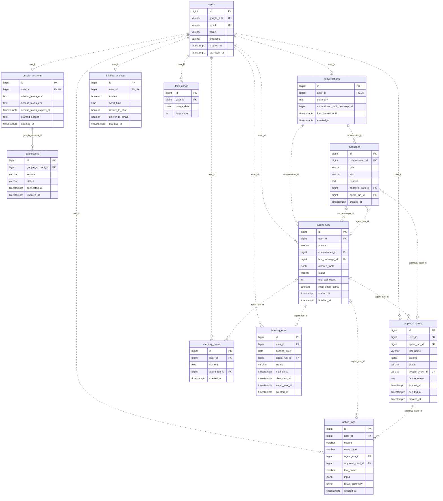

# ERD

v1의 테이블 12개와 관계다. 모듈과 애그리거트 설명은 [architecture.md](architecture.md)에 있다. 테이블은 각 티켓에서 처음 쓸 때 Flyway 마이그레이션으로 만든다. 만들면서 바뀐 컬럼은 이 문서도 함께 고친다.

## 공통 규칙

- **ID**: `bigint` 자동 증가(identity).
- **시각**: 모두 `timestamptz`. "오늘"처럼 날짜 경계가 필요하면 `users.timezone` 기준으로 계산한다.
- **상태값**: PostgreSQL enum 대신 `varchar`에 JPA `EnumType.STRING`으로 저장한다.
- **도구마다 모양이 다른 값**: `jsonb` (ADR 0003).
- **참조**: 다른 애그리거트는 ID 컬럼으로만 가리키고 FK 제약은 건다. JPA 연관관계는 같은 애그리거트 안에서만 쓴다 (ADR 0006).
- **원문 저장 안 함**: 메일 본문 같은 외부 원문은 어느 테이블에도 저장하지 않는다.

## 다이어그램

실선(`--`)은 같은 애그리거트 안의 관계(JPA 연관관계)이고, 점선(`..`)은 ID로만 가리키는 관계다.

## 테이블별 설명

설명이 필요한 컬럼만 적는다. `id`, `created_at` 같은 공통 컬럼은 생략한다.

### auth

**users**: 로그인한 사용자. 예약어 `user`를 피해 복수형으로 짓는다 (ADR 0003).

| 컬럼 | 설명 |
|---|---|
| `google_sub` | Google 계정의 고유 ID. 이메일은 바뀔 수 있어서 이 값으로 사람을 구분한다 |
| `email` | 허용된 이메일 목록과 비교하는 값. 브리핑 메일의 받는 사람 |
| `timezone` | `Asia/Seoul` 같은 IANA 이름. 루프, 브리핑, 하루 상한이 모두 이 값을 쓴다. 첫 로그인 때 브라우저 값으로 채운다 |

로그인 세션은 DB에 두지 않는다. 서버를 다시 켜면 다시 로그인한다.

### connection

**google_accounts**: 애그리거트 루트. Google 토큰을 담고, 사용자당 한 줄이며 캘린더와 Gmail이 같이 쓴다.

| 컬럼 | 설명 |
|---|---|
| `refresh_token_enc` | 암호화한 갱신 토큰. 암호화 키는 환경 변수로 받는다 |
| `access_token_enc`, `access_token_expires_at` | 암호화한 접근 토큰 캐시. 비었거나 만료됐으면 갱신 토큰으로 다시 받는다 |
| `granted_scopes` | Google이 실제로 준 권한 목록(공백으로 구분). 브리핑 메일 발송 권한(`gmail.send`)이 있는지도 여기서 본다 |

연결을 하나 끊으면 토큰을 철회하고 남은 권한으로 다시 받는다 (ADR 0007). 모두 끊으면 줄은 남기고 토큰만 비운다.

**connections**: `google_accounts`의 자식 엔티티. 서비스마다 한 줄. (`google_account_id`, `service`) 유일.

| 컬럼 | 설명 |
|---|---|
| `service` | `CALENDAR`, `GMAIL`. Gmail 발송은 연결이 아니라 브리핑 설정에서 켜는 권한이라 줄을 두지 않는다 |
| `status` | `CONNECTED`, `NEEDS_RECONNECT`, `DISCONNECTED` |

### conversation

**conversations**: 대화방. 사용자당 하나.

| 컬럼 | 설명 |
|---|---|
| `summary`, `summarized_until_message_id` | 최근 20개보다 오래된 대화의 요약과, 요약에 포함된 마지막 메시지 |
| `loop_locked_until` | 루프 잠금. 비었거나 지난 시각일 때만 조건부 UPDATE로 잡는다. 서버가 죽어도 이 시각이 지나면 풀린다 (ADR 0008) |

**messages**: 화면에 보이는 메시지만 저장한다. 도구 호출과 결과는 저장하지 않는다. 대화방과는 다른 애그리거트라 `conversation_id`로만 가리킨다. (`conversation_id`, `id`) 인덱스.

| 컬럼 | 설명 |
|---|---|
| `role` | `USER`, `ASSISTANT`, `SYSTEM`(승인 결과 같은 정해진 문구) |
| `kind` | `TEXT`, `APPROVAL_CARD`, `BRIEFING`. 화면이 어떤 모양으로 그릴지 정한다 |
| `approval_card_id` | 카드 메시지와 승인 결과 메시지가 가리키는 카드. 카드 내용은 승인 카드에서 읽는다 |
| `agent_run_id` | 비서의 답이 나온 루프 |

### agent

**agent_runs**: 루프 실행 기록. Python이 도구를 부탁할 때마다 이 ID를 붙이고, Spring은 이 줄로 허용 여부를 확인한다.

| 컬럼 | 설명 |
|---|---|
| `source` | `CHAT`, `BRIEFING` |
| `conversation_id` | 대화에서 시작했을 때만. 브리핑은 비어 있다 |
| `last_message_id` | 이 루프에 넣은 마지막 사용자 메시지. 루프가 끝난 뒤 이보다 새 메시지가 있으면 대기열을 이어서 처리한다 (ADR 0008) |
| `allowed_tools` | 허용된 도구 이름 배열. Python에 보낸 목록과 같다 |
| `status` | `RUNNING`, `COMPLETED`, `LIMIT_REACHED`(도구 10번 초과), `FAILED` |
| `tool_call_count` | 도구 부탁을 받을 때마다 올린다. 10을 넘으면 거절한다 |
| `read_email_called` | `read_email`을 부르면 true. 그 뒤의 `add_memory_note`를 거절하는 근거 |

### approval

**approval_cards**: 승인 카드. 조건은 만든 뒤 바뀌지 않는다. (`status`, `expires_at`) 인덱스로 만료 작업이 찾는다.

| 컬럼 | 설명 |
|---|---|
| `agent_run_id` | 카드를 만든 루프. 대화방은 이 루프에서 알 수 있다 |
| `tool_name` | v1은 `create_event`뿐 |
| `params` | 고정된 조건(제목, 시작·끝 시각, 장소 등) |
| `status` | `PENDING`, `EXECUTING`, `COMPLETED`, `FAILED`, `REJECTED`, `EXPIRED` (ADR 0004) |
| `google_event_id` | 카드 ID로 만든 일정 ID(예: `mpcard42`). Google 일정 ID에는 `a`~`v` 소문자와 숫자만 쓸 수 있다. 다시 시도해도 같은 값을 쓴다 |
| `failure_reason` | 실패했을 때 화면에 보일 이유 |
| `expires_at`, `decided_at` | 만든 시각 + 24시간, 승인·거절한 시각 |

### actionlog

**action_logs**: 행동 기록. 쌓기만 하고 고치지 않는다. (`user_id`, `created_at`) 인덱스로 시간순 조회한다.

| 컬럼 | 설명 |
|---|---|
| `source` | `CHAT`, `BRIEFING`, `USER`(사용자가 직접 한 일: 카드 승인, 메모 삭제) |
| `event_type` | `TOOL_CALLED`, `TOOL_REJECTED`, `CARD_CREATED`, `CARD_APPROVED`, `CARD_REJECTED`, `CARD_EXPIRED`, `CARD_EXECUTED`, `CARD_FAILED`, `MEMORY_ADDED`, `MEMORY_DELETED`, `LOOP_LIMIT_REACHED` |
| `input` | 도구 입력값(검색어, 기간 등). `MEMORY_DELETED`에는 지운 메모 내용을 담는다 |
| `result_summary` | 결과 요약만: 메일 제목·보낸 사람, 일정 건수 등. 메일 본문은 넣지 않는다 |

### memory

**memory_notes**: 기억 메모. 지우면 줄을 삭제한다. 개수(예: 50개)와 길이(예: 200자) 상한은 설정값이라 애플리케이션에서 확인한다.

### briefing

**briefing_settings**: 사용자당 하나. `send_time`은 `users.timezone` 기준 시각이고, `deliver_to_chat`과 `deliver_to_email`은 둘 다 켤 수 있다.

**briefing_runs**: 브리핑 발송 기록. (`user_id`, `briefing_date`) 유일이라 같은 날 두 번 보내지 않는다.

| 컬럼 | 설명 |
|---|---|
| `briefing_date` | 사용자 시간대 기준 날짜 |
| `status` | `RUNNING`, `SENT`, `FAILED`, `SKIPPED`(놓친 지 따라잡기 시간을 넘김) |
| `mail_since` | "새로 온 메일"의 기준 시각. 지난 `SENT` 브리핑 시각이고, 첫 브리핑은 24시간 전 |
| `chat_sent_at`, `email_sent_at` | 받는 곳별로 보낸 시각. 하나만 실패해도 어디까지 갔는지 안다 |

### usage

**daily_usage**: 하루 호출 상한. (`user_id`, `usage_date`) 유일. `loop_count`는 그날 돌린 루프 수(대화 + 브리핑)이고, `loop_count < 상한` 조건부 UPDATE로 올린다. 대화 요약 호출은 세지 않는다.
